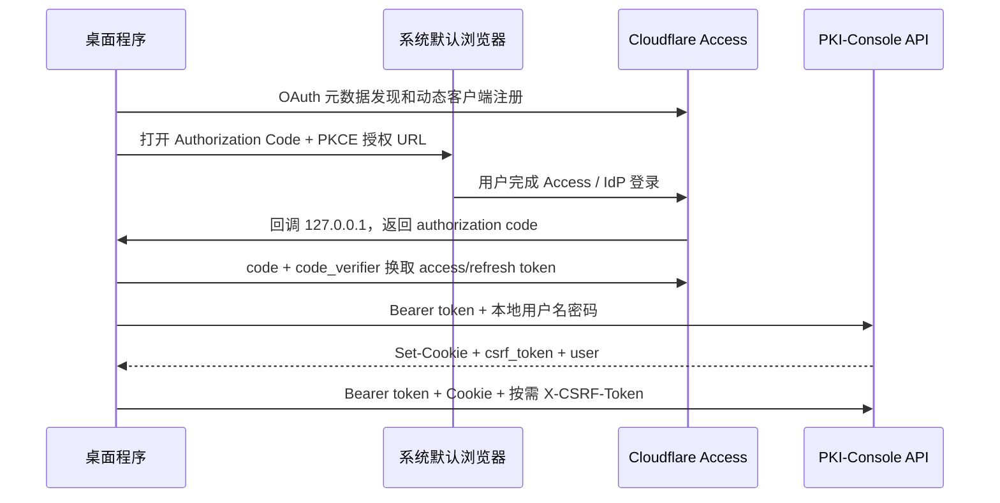

# PKI-Console 桌面客户端集成指南

本文面向开发 PKI-Console 桌面客户端的工程师，说明如何使用系统默认浏览器完成
Cloudflare Access 授权，再在桌面程序中使用 PKI-Console 本地用户名和密码建立应用会话。
本文不要求桌面程序嵌入 WebView，也不要求读取浏览器 Cookie。

本文以生产管理入口 `https://pki-console.altasci.com` 为例。REST 接口契约见
[openapi.yaml](openapi.yaml)，该文件使用 OpenAPI 3.1。Cloudflare 管理的 OAuth
发现、授权和令牌端点不属于 PKI-Console REST API，因此应在运行时发现，不能从
OpenAPI 文件中硬编码。

## 1. 认证模型

一次完整登录包含两个相互独立的认证层：

1. **Cloudflare Access**：确认当前设备上的人员满足 Console 的 Access Policy。
   桌面程序通过 Authorization Code + PKCE 获取一个不透明 OAuth access token。
2. **PKI-Console 本地账户**：用户在桌面程序中输入用户名和密码，程序调用
   `POST /api/v1/auth/login`，获得应用会话 Cookie 和 CSRF token。



每次 Console API 请求都必须先通过 Cloudflare。Cloudflare 验证桌面程序发送的
Bearer token 后，会在其可信链路上为源站生成 `Cf-Access-Jwt-Assertion`。桌面程序
不得自行构造 `Cf-Access-Jwt-Assertion`、`Cf-Access-Authenticated-User-Email` 或
任何 `X-PKI-*` 内部头。

普通 `operator` 和 `user` 账户在应用层只需要本地用户名和密码。`super_admin`
还需要 TOTP，而且 Cloudflare 身份邮箱必须与根账户邮箱一致。当前实现不会把普通
用户的 Access 邮箱绑定到同名本地账户：Access 是入口身份，最终权限由本地登录账户
决定。如果产品需要一一绑定两种身份，需要先扩展后端数据模型和登录校验。

## 2. 服务地址

| 用途 | 地址 |
| --- | --- |
| Console OAuth resource | `https://pki-console.altasci.com` |
| OAuth protected-resource 元数据 | 从未授权响应的 `WWW-Authenticate` 中读取 `resource_metadata` URL |
| OAuth 授权服务器元数据 | 从 protected-resource 元数据的 `authorization_servers` 中发现 |
| Console REST API base | `https://pki-console.altasci.com/api/v1` |
| PKI-Console 登录 | `POST https://pki-console.altasci.com/api/v1/auth/login` |
| OpenAPI 3.1 规范 | [openapi.yaml](openapi.yaml) |
| 匿名公共 PKI 服务 | `https://pki.altasci.com` |

不要把用户名、密码或 Console 会话发送到匿名公共域名 `pki.altasci.com`。

## 3. Cloudflare 管理员前置配置

客户端开发者开始联调前，管理员需要在保护 `pki-console.altasci.com` 的 Self-hosted
Access Application 上完成以下配置：

1. 在 **Advanced settings** 中启用 **Managed OAuth**。
2. 启用 Dynamic Client Registration。
3. 启用 **Allow loopback clients**，允许原生应用使用
   `http://127.0.0.1:<随机端口>/oauth/callback`。
4. Access Allow Policy 必须包含实际参与联调和使用的人员邮箱或受控企业邮箱域；不要
   使用 `Include Everyone`。
5. 建议 access token 有效期设为 5–15 分钟，grant/refresh session 设为 1–2 周，
   并让客户端实现静默刷新。

如果 Managed OAuth 尚未启用，非浏览器 HTTP 客户端通常只会收到无法直接使用的
Access 登录重定向。启用后，未授权客户端会收到带 `WWW-Authenticate` 的 `401`，
其中指向 OAuth 发现信息。

## 4. 在桌面程序中完成 OAuth

应优先使用支持 OAuth 2.0 Authorization Code、PKCE、RFC 8707 resource indicator、
动态客户端注册和原生应用 loopback redirect 的成熟库。不要使用 Resource Owner
Password、抓取 Access 登录表单或在程序中保存用户的 IdP 密码。

### 4.1 创建本地回调监听器

在打开浏览器之前，在 loopback 地址上选择一个由操作系统分配的临时端口，例如：

```text
http://127.0.0.1:49152/oauth/callback
```

只监听 `127.0.0.1`，不要监听 `0.0.0.0`。回调处理器应只接受预期路径和一次请求，
收到结果后立即关闭监听器。浏览器完成回调后可以显示一段固定文本，例如“授权已完成，
可以关闭此页面”。

### 4.2 发现 protected resource 和授权服务器

先在不自动跟随重定向的情况下请求 Console 端点，例如：

```http
GET /api/v1/version HTTP/1.1
Host: pki-console.altasci.com
Accept: application/json
```

预期得到 `401`，其 `WWW-Authenticate: Bearer ...` 参数中包含 `resource_metadata`。
请求该 HTTPS URL，并校验响应的 `resource` 是预期的 Console origin；然后从
`authorization_servers` 选择授权服务器。一个典型的 protected-resource 元数据地址是：

```text
https://pki-console.altasci.com/.well-known/cloudflare-access-protected-resource/
```

再请求授权服务器的 `/.well-known/oauth-authorization-server`，从响应中读取实际的
`authorization_endpoint`、`token_endpoint`、`registration_endpoint`、
`revocation_endpoint`、支持的 PKCE 方法和其他能力。不要拼接或硬编码 team domain 或
Cloudflare OAuth 端点。

客户端必须确认元数据声明支持：

- `authorization_code` grant；
- public client 所需的 `token_endpoint_auth_methods_supported: none`；
- PKCE `S256`；
- 动态注册所需的 `registration_endpoint`。

发现到的 URL 必须使用 HTTPS，并应限制在用户选择的 PKI-Console 部署所公布的授权服务器
范围内，避免把注册信息或 token 发送到未受信任 host。

### 4.3 动态注册公共客户端

如果尚未为本次安装注册客户端，向元数据中的 `registration_endpoint` 提交类似请求：

```json
{
  "client_name": "Example PKI Desktop",
  "redirect_uris": [
    "http://127.0.0.1:49152/oauth/callback"
  ],
  "grant_types": [
    "authorization_code",
    "refresh_token"
  ],
  "response_types": [
    "code"
  ],
  "token_endpoint_auth_method": "none",
  "resource": "https://pki-console.altasci.com"
}
```

桌面程序属于 public client，不能安全保存内置 `client_secret`。保存注册响应中的
`client_id` 和必要的客户端元数据即可。如果服务端返回注册管理凭据，应与 OAuth token
一样放入操作系统凭据存储。具体字段以服务器元数据和注册响应为准。

注册的 redirect URI 与授权请求必须匹配。若下一次启动使用了不同的临时端口，不要假设
旧 `client_id` 一定允许新的 URI；应遵循 Cloudflare 返回的注册元数据和所用 OAuth 库的
loopback-port 处理方式，必要时用新的完整 redirect URI 重新动态注册。

### 4.4 生成 PKCE 和 state

每次授权都必须重新生成：

- `code_verifier`：使用密码学安全随机数，编码为 43–128 个 Base64URL 字符；
- `code_challenge = BASE64URL_NO_PADDING(SHA256(code_verifier))`；
- `state`：至少 128 bit 随机值，用于绑定浏览器回调和本次授权事务。

Cloudflare 当前要求 `code_challenge` 以 ASCII 字母或数字开头。如果生成值以 `-` 或 `_`
开头，应重新生成 verifier/challenge。该要求比通用 PKCE Base64URL 语法更严格。

`code_verifier` 和 `state` 只保存在本次登录的短期内存中，不写日志。

### 4.5 打开系统默认浏览器

使用元数据返回的 `authorization_endpoint` 构造授权 URL，至少包含：

```text
response_type=code
client_id=<动态注册得到的 client_id>
redirect_uri=http://127.0.0.1:49152/oauth/callback
code_challenge=<PKCE challenge>
code_challenge_method=S256
state=<随机 state>
resource=https://pki-console.altasci.com
```

如元数据要求 `scope`，只请求服务端公布且客户端实际需要的 scope。通过操作系统 API
打开默认浏览器，不要在嵌入式 WebView 中收集 Access 或 IdP 凭据。

### 4.6 校验回调并交换 token

回调到达后：

1. 拒绝缺少 `code`、携带 OAuth `error` 或路径不匹配的请求；
2. 使用恒定时间比较确认返回的 `state` 与本次请求完全一致；
3. 将 authorization code、原始 `code_verifier` 和完全相同的 `redirect_uri` 提交到
   元数据中的 `token_endpoint`。

典型 token 请求使用 `application/x-www-form-urlencoded`：

```text
grant_type=authorization_code
client_id=<client_id>
code=<authorization_code>
redirect_uri=http://127.0.0.1:49152/oauth/callback
code_verifier=<原始 verifier>
```

Cloudflare Managed OAuth 返回的是不透明 access token，不是供客户端解析或验证的 JWT。
客户端只根据 `token_type`、`expires_in` 等响应字段管理它，并在请求中发送：

```http
Authorization: Bearer <opaque-access-token>
```

access token、refresh token 和注册管理凭据必须存入 Windows Credential Manager、
macOS Keychain、Linux Secret Service 或同等级安全存储，不能写入普通配置文件或日志。

### 4.7 刷新 Access token

在 access token 到期前，使用发现到的 `token_endpoint` 和 refresh token 静默刷新：

```text
grant_type=refresh_token
client_id=<client_id>
refresh_token=<refresh_token>
```

若响应返回新的 refresh token，必须原子替换旧值。刷新失败或 grant 到期时，删除不可用
token 并重新打开系统浏览器授权。不要无限重试失败的刷新请求。

## 5. 使用本地用户名密码登录 PKI-Console

OAuth 成功后，提示用户在桌面程序中输入 PKI-Console 本地用户名和密码。OAuth access
token 必须附加在登录请求上，否则请求会在 Cloudflare 层失败，无法到达登录处理器。

```http
POST /api/v1/auth/login HTTP/1.1
Host: pki-console.altasci.com
Authorization: Bearer <opaque-access-token>
Accept: application/json, application/problem+json
Content-Type: application/json

{
  "login": "alice",
  "password": "correct horse battery staple"
}
```

普通账户不要发送空字符串 `totp`；直接省略该字段。若桌面客户端支持超级管理员登录，
请求还需要六位 TOTP：

```json
{
  "login": "root@example.com",
  "password": "...",
  "totp": "123456"
}
```

成功响应同时包含 HTTP `Set-Cookie` 和 JSON：

```json
{
  "user": {
    "id": "7d91c35c-7546-4c53-8ca5-b32e8071df8e",
    "username": "alice",
    "role": "user",
    "status": "active"
  },
  "csrf_token": "<opaque-csrf-token>",
  "expires_at": "2026-08-26T12:00:00Z"
}
```

客户端必须使用支持 Cookie Jar 的 HTTP 客户端保存响应中的
`__Host-pki_session` Cookie。它是 `Secure`、`HttpOnly`、host-only 且 `Path=/`；不要
尝试从系统浏览器 Cookie 仓库复制 Cloudflare 或 PKI-Console Cookie。将 JSON 中的
`csrf_token` 与该应用会话关联，优先保存在进程内存或操作系统安全存储。

## 6. 调用业务 API

完成两层认证后，每个受保护的 Console 业务请求都需要：

- `Authorization: Bearer <Cloudflare access token>`；
- Cookie Jar 自动发送的 `__Host-pki_session`；
- 对 `POST`、`PUT`、`PATCH`、`DELETE` 发送 `X-CSRF-Token`；
- 对需要安全重试的关键写操作发送 8–128 字符的 `Idempotency-Key`，建议使用 UUID。

读取当前会话：

```http
GET /api/v1/auth/session HTTP/1.1
Host: pki-console.altasci.com
Authorization: Bearer <opaque-access-token>
Cookie: __Host-pki_session=<session-token>
Accept: application/json, application/problem+json
```

写操作示例：

```http
POST /api/v1/certificate-requests HTTP/1.1
Host: pki-console.altasci.com
Authorization: Bearer <opaque-access-token>
Cookie: __Host-pki_session=<session-token>
X-CSRF-Token: <csrf-token>
Idempotency-Key: 83a13b13-7035-4e7c-a267-8462ec7a787c
Content-Type: application/json

{ "...": "字段见 OpenAPI" }
```

不要关闭 TLS 证书验证，不要自动把 `Authorization`、Cookie 或 CSRF token 转发到重定向
后的其他 host。原生 HTTP 客户端不受浏览器 CORS 限制；不要为了调用 API 而在 WebView
中运行跨域 JavaScript。

## 7. 会话状态与错误恢复

客户端应分别管理 Cloudflare OAuth 状态和 PKI-Console 会话状态：

| 状态 | 处理方式 |
| --- | --- |
| 没有有效 OAuth token | 打开系统浏览器完成 Authorization Code + PKCE |
| OAuth 有效、没有应用会话 | 显示 PKI-Console 用户名密码表单并调用 `/auth/login` |
| 两层认证都有效 | 调用业务 API |
| OAuth token 即将过期 | 使用 refresh token 静默刷新 |
| 应用会话过期、OAuth 仍有效 | 只需重新输入 PKI-Console 用户名密码 |
| refresh token 失效 | 清除 OAuth token，重新进行浏览器授权 |

常见响应：

| 响应 | 含义与处理 |
| --- | --- |
| `401` 且带 OAuth `WWW-Authenticate` | Cloudflare 凭据缺失或过期；刷新或重新浏览器授权 |
| `401`，Problem code 为 `invalid_credentials` | 本地用户名、密码、TOTP 或管理员 Access 身份不正确；不要自动重试密码 |
| `401`，Problem code 为 `authentication_required` / `authentication_failed` | 应用 Cookie、CSRF 或会话已失效；清除应用会话并重新本地登录 |
| `403` | 当前本地角色或 CA grant 无权执行该操作 |
| `409` | 幂等键冲突或业务状态冲突；读取 Problem detail 和 `X-Request-ID` |
| `429` | 受到速率限制；遵守 `Retry-After`，不要紧密重试 |

HTTP 客户端不应自动跟随把 API 请求带到 HTML 登录页的跨 host 重定向。刷新 token 后最多
自动重放一次幂等请求；非幂等写操作只有在使用相同 `Idempotency-Key` 时才能安全重试。

## 8. 退出登录

退出 PKI-Console 应用会话：

```http
POST /api/v1/auth/logout HTTP/1.1
Host: pki-console.altasci.com
Authorization: Bearer <opaque-access-token>
Cookie: __Host-pki_session=<session-token>
X-CSRF-Token: <csrf-token>
```

成功返回 `204 No Content` 并清除应用 Cookie。客户端也应删除本地保存的应用 Cookie 和
CSRF token。

该接口不会撤销 Cloudflare OAuth grant。若用户选择“从此设备完全退出”，还应清除本地
access/refresh token；如果 OAuth 元数据公布了 revocation endpoint，可按其声明调用。

## 9. OpenAPI 代码生成

现有规范位于 [openapi.yaml](openapi.yaml)。代码生成后通常仍需增加一个客户端级认证
拦截器，因为 OpenAPI 生成器不会自动完成 Cloudflare 的元数据发现、动态客户端注册、
系统浏览器回调和 token 刷新。

拦截器至少应完成：

1. 在所有 `pki-console.altasci.com` 请求上注入当前 Bearer token；
2. 使用同一个 Cookie Jar 维护 `__Host-pki_session`；
3. 对非 `GET`、`HEAD`、`OPTIONS` 方法注入当前 `X-CSRF-Token`；
4. 只向声明支持幂等的关键写操作添加 `Idempotency-Key`；
5. 将 `application/problem+json` 解析为结构化错误，并记录非敏感的 `request_id`。

规范中的 Cloudflare bearer security scheme 表示桌面程序实际发送的 Managed OAuth token。
Cloudflare 注入的源站 JWT 不是客户端输入，也不应出现在生成客户端的公共 API 中。

## 10. 安全与验收清单

- [ ] 使用系统默认浏览器，不使用嵌入式 WebView 收集 IdP 凭据。
- [ ] loopback listener 只绑定 `127.0.0.1` 随机端口，并在一次回调后关闭。
- [ ] 每次授权重新生成并校验 PKCE `S256` 和 `state`。
- [ ] PKCE challenge 以 ASCII 字母或数字开头。
- [ ] 从 `WWW-Authenticate` 开始发现 resource 和授权服务器，所有 OAuth 端点均来自元数据。
- [ ] public client 不在程序包中内置 OAuth client secret。
- [ ] access/refresh token 存放在操作系统安全存储且从不写日志。
- [ ] 登录请求携带 Bearer token，成功后保存 Cookie 和 CSRF token。
- [ ] 除本地登录及应用层健康/版本端点外，受保护业务请求都携带 Bearer token 和应用 Cookie。
- [ ] 所有非安全方法都携带 CSRF token。
- [ ] 不构造任何 `Cf-Access-*` 或 `X-PKI-*` 请求头。
- [ ] 正确区分 OAuth 过期和 PKI-Console 会话过期。
- [ ] 完全退出时清除 OAuth token、Cookie、CSRF token 和内存中的密码。

## 参考资料

- [Cloudflare Managed OAuth](https://developers.cloudflare.com/cloudflare-one/access-controls/applications/http-apps/managed-oauth/)
- [Cloudflare 非浏览器客户端 OAuth 示例](https://developers.cloudflare.com/cloudflare-one/access-controls/authenticate-agents/)
- [RFC 8252: OAuth 2.0 for Native Apps](https://www.rfc-editor.org/rfc/rfc8252)
- [RFC 7636: Proof Key for Code Exchange](https://www.rfc-editor.org/rfc/rfc7636)
- [RFC 8707: Resource Indicators for OAuth 2.0](https://www.rfc-editor.org/rfc/rfc8707)
- [RFC 8414: OAuth 2.0 Authorization Server Metadata](https://www.rfc-editor.org/rfc/rfc8414)
- [RFC 7591: OAuth 2.0 Dynamic Client Registration](https://www.rfc-editor.org/rfc/rfc7591)
